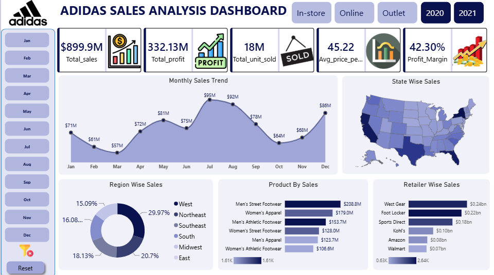

# Adidas Sales Analysis | SQL & Power BI

## Project Overview

This project focuses on analyzing Adidas sales data using **MySQL** and **Power BI**. The goal is to explore sales performance, identify trends, evaluate product and retailer performance, and generate meaningful business insights.

The project combines SQL-based data analysis with an interactive Power BI dashboard to present findings in a clear and structured way.

## Project Objectives

- Analyze overall sales and revenue performance.
- Identify top-performing products and retailers.
- Compare sales across regions, states, and cities.
- Understand sales performance across different sales methods.
- Analyze monthly, quarterly, and yearly sales trends.
- Identify key business insights and recommendations.
- Build an interactive Power BI dashboard for data visualization.

## Tools & Technologies

- **MySQL Workbench** – Data querying and analysis
- **Power BI** – Dashboard development and visualization
- **Microsoft Excel / CSV** – Dataset
- **GitHub** – Project documentation and version control

## Project Structure

```text
Adidas-Sales-Analysis/
│
├── Dashboard/
│   ├── Adidas_Dashboard.pbix
│   ├── Dashboard_screenshot.png
│   └── README.md
│
├── Dataset/
│   └── Adidas US Sales_Datasets.xlsx
│
├── Images/
│   ├── Adidas_logo.png
│   ├── Avg price per unit.png
│   ├── Clear_filter.png
│   ├── Dashboard_screenshot.png
│   ├── Profit Margin.png
│   ├── Total Profit.png
│   ├── Total Sales.png
│   └── Total unit sold.png
│
├── SQL/
│   ├── 01_database_setup.sql
│   ├── 02_data_import_validation.sql
│   ├── 03_data_quality_checks.sql
│   ├── 04_sales_kpis.sql
│   ├── 05_product_analysis.sql
│   ├── 06_retailer_analysis.sql
│   ├── 07_regional_sales_analysis.sql
│   ├── 08_state_city_analysis.sql
│   ├── 09_sales_method_analysis.sql
│   ├── 10_monthly_sales_analysis.sql
│   ├── 11_time_based_analysis.sql
│   ├── 12_business_questions.sql
│   ├── 13_advanced_sql.sql
│   ├── 14_final_business_insights.sql
│   └── README.md
│
└── README.md
```

## SQL Analysis

The SQL analysis is organized into multiple files, covering:

- Database setup and data import validation
- Data quality checks
- Overall sales KPIs
- Product and retailer performance
- Regional, state, and city-wise sales analysis
- Sales method analysis
- Monthly and time-based sales trends
- Business questions and advanced SQL queries
- Final business insights and recommendations

Detailed key findings and recommendations are documented within the respective SQL files and consolidated in the final business insights file.

## Power BI Dashboard

An interactive Power BI dashboard was created to visualize important sales metrics and business performance.

**Dashboard Preview**



**Power BI File:** [View Adidas Dashboard](./Dashboard/Adidas_Dashboard.pbix)

For more details about the dashboard, refer to the [Dashboard README](./Dashboard/README.md).

## Dataset

The dataset contains Adidas sales records for **2020 and 2021**.

It includes information such as:

- Retailer
- Retailer location
- Product category
- Price per unit
- Units sold
- Total sales
- Operating profit
- Operating margin
- Sales method
- Invoice date

The dataset is used for learning and analysis purposes.

## Key Learning Outcomes

Through this project, I gained practical experience in:

- Writing SQL queries for business analysis.
- Using aggregate functions, joins, subqueries, and window functions.
- Performing data quality checks.
- Analyzing sales trends and business performance.
- Creating interactive dashboards in Power BI.
- Translating analytical findings into business insights and recommendations.

## Future Improvements

- Add more advanced business analysis.
- Enhance dashboard interactivity.
- Include additional KPIs and visualizations.
- Explore sales forecasting and predictive analysis.

## Author

**Ankit Patel**  
BCA | Data Science & AI  
Aspiring Data Analyst

---

*This project was created for learning and practical application of SQL and Power BI skills.*
